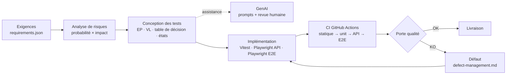

# Workflow QA — Nous AI News

Ce dossier décrit comment la qualité est **conçue, mesurée et contrôlée** sur ce projet. Il suit le référentiel **ISTQB Foundation Level** (processus de test, niveaux, types, techniques de conception, gestion des risques et des défauts) et intègre l'**IA générative** comme assistant de test sous contrôle humain.

## Documents

| Document | Contenu |
|---|---|
| [test-strategy.md](test-strategy.md) | Objectifs, principes ISTQB appliqués, niveaux et types de test, critères d'entrée/sortie, métriques |
| [test-plan.md](test-plan.md) | Périmètre, approche par module, outillage, exécution, livrables |
| [risk-analysis.md](risk-analysis.md) | Analyse de risques produit (probabilité × impact) et priorisation des tests |
| [test-design-techniques.md](test-design-techniques.md) | Techniques ISTQB utilisées, avec les cas de test réels du dépôt |
| [genai-testing.md](genai-testing.md) | Principes d'usage de la GenAI en test, risques, workflow et checklist de revue |
| [prompts/prompt-library.md](prompts/prompt-library.md) | Bibliothèque de prompts réutilisables pour l'analyse, la conception et la revue de tests |
| [ai-assistance-log.md](ai-assistance-log.md) | Journal de transparence : ce que l'IA a produit, ce qui a été vérifié, ce qui reste à relire |
| [defect-management.md](defect-management.md) | Cycle de vie d'un défaut, sévérité/priorité, journal des défauts trouvés |
| [requirements.json](requirements.json) | Référentiel d'exigences testables (source de vérité de la traçabilité) |
| [traceability-matrix.md](traceability-matrix.md) | Matrice exigences → tests, **générée** et contrôlée en CI |

## Vue d'ensemble du workflow



## Pyramide de tests

```
            ┌───────────────┐
            │  E2E (Playwright)   navigateur : parcours, a11y, responsive
            ├───────────────────┤
            │  API (Playwright)   contrat HTTP : statuts, formats, validation, sécurité
        ┌───┴───────────────────┴───┐
        │  Unitaire (Vitest)          logique métier, validateurs, bornes, états
        └───────────────────────────┘
```

Règle d'or : **tester au niveau le plus bas qui détecte le défaut**. Un cas de valeurs limites se teste en unitaire (rapide, précis) puis une seule fois en API (contrat) — pas dix fois en E2E.

## Organisation par modules

Chaque module métier possède ses tests à chaque niveau, dans le même nom de dossier :

| Module | Exigences | `tests/unit/` | `tests/api/` | `tests/e2e/` |
|---|---|:-:|:-:|:-:|
| `articles` | ART-01 → 04 | ✔ | ✔ | ✔ |
| `search` | SRC-01 → 03 | ✔ | ✔ | ✔ |
| `topics` | TOP-01 → 02 | ✔ | ✔ | ✔ |
| `newsletter` | NEW-01 → 03 | ✔ | ✔ | ✔ |
| `bookmarks` | BKM-01 → 03 | ✔ | — (état côté navigateur) | ✔ |
| `platform` | PLT-01 → 07 | ✔ | ✔ | ✔ |
| `data` | PLT-07 | ✔ | — | — |

```bash
npm run test:module -- search            # tous niveaux du module
npm run test:module -- newsletter --api  # un seul niveau
npm run test:module -- bookmarks --e2e --mobile
```

## Commandes utiles

| Commande | Rôle |
|---|---|
| `npm run test:unit` / `test:unit:cov` | Tests unitaires (avec seuils de couverture) |
| `npm run test:api` | Tests de contrat HTTP |
| `npm run test:e2e` | Parcours navigateur (desktop + mobile) |
| `npm run test:smoke` | Parcours critiques (tag `@smoke`), exécutés aussi sur mobile |
| `npm run test:all` | Typage + unitaire + API + E2E |
| `npm run qa:trace` | Contrôle de traçabilité exigences → tests |
| `npm run qa:prompt -- --req NEW-02 --technique decision-table` | Génère un prompt de conception de tests (GenAI) |
| `npm run qa:report` | Ouvre le dernier rapport HTML Playwright |
