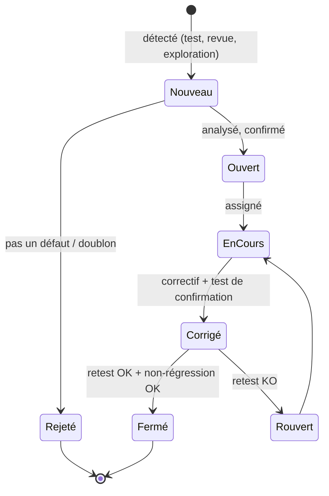

# Gestion des défauts

## 1. Cycle de vie

Règle : **un défaut n'est fermé que s'il existe un test automatisé qui l'aurait détecté** (test de confirmation conservé dans la suite). C'est ce qui transforme la correction en protection durable contre la régression.

## 2. Sévérité et priorité

| Sévérité (impact technique/utilisateur) | Définition |
|---|---|
| **Critique** | Perte de données, faille de sécurité exploitable, site inutilisable |
| **Majeure** | Fonction principale incorrecte, sans contournement simple |
| **Mineure** | Fonction secondaire dégradée ou contournement évident |
| **Cosmétique** | Défaut visuel ou de formulation sans impact fonctionnel |

La **priorité** (urgence de correction) est décidée par le métier/mainteneur et peut différer de la sévérité : un défaut cosmétique sur la page d'accueil peut être prioritaire ; un défaut majeur sur une fonction jamais utilisée peut attendre.

## 3. Modèle de rapport

Utiliser le [formulaire GitHub](../../.github/ISSUE_TEMPLATE/bug_report.md) : titre, environnement, étapes de reproduction, résultat attendu / obtenu, sévérité proposée, exigence (`REQ-…`), test associé, pièces jointes (capture, trace Playwright).

## 4. Journal des défauts trouvés lors de la refonte

Ces défauts ont été **détectés par la suite de tests elle-même** pendant la construction, puis corrigés ; chacun reste couvert par un test de confirmation.

| ID | Sévérité | Module | Description | Détecté par | Cause | Statut | Test de confirmation |
|---|---|---|---|---|---|---|---|
| **DEF-001** | **Majeure** (sécurité) | newsletter | Le validateur d'e-mail acceptait du HTML dans la partie locale : `@x.fr` était inscrit (HTTP 201). Risque de stockage d'une charge hostile réaffichée plus tard. | `NEW-API-014` (devinette d'erreurs) | Motif trop permissif (`[^\s@]+` pour la partie locale) | Fermé | `NEW-API-014`, `NEW-E2E-012`, unit `[REQ-NEW-02]` « caractères interdits » |
| **DEF-002** | Mineure | newsletter | Un label DNS de 64 caractères (limite RFC 1035 : 63) était accepté. | Test unitaire aux valeurs limites (label 63/64) | Le motif du TLD, sans borne haute, s'appliquait à tous les labels | Fermé | unit `[REQ-NEW-02]` « domaine » |
| **DEF-003** | **Majeure** | articles | Le tri `newest` renvoyait les articles du plus **ancien** au plus récent (signe inversé dans le comparateur) : la page d'accueil et l'API affichaient l'ordre inverse. | Tests unitaires de tri et d'intégrité des données (avant tout E2E) | Erreur de signe dans `compareArticles` | Fermé | unit `[REQ-ART-01]` « tri », `ART-API-003`, `ART-E2E-002` |

### Défauts de test (non-produit) rencontrés

Distinguer un défaut du produit d'un défaut du test évite de « corriger » le mauvais objet.

| Constat | Nature | Correction |
|---|---|---|
| `NEW-API-007/008` recevaient 422 au lieu de 400 | **Défaut de test** : Playwright ré-encode en JSON toute chaîne non-JSON lorsque `Content-Type: application/json`, masquant le JSON invalide | Envoi d'un `Buffer` brut |
| `ART-E2E-010/015` : violation du mode strict (3 éléments) | **Défaut de test** : locator trop large (le `data-testid` existe aussi dans les cartes « À lire aussi ») | Ajout d'un `data-testid="article-header"` pour borner le locator |

## 5. Métriques de défauts

Suivre par module et par sévérité : nombre de défauts, **phase de détection** (unitaire / API / E2E / exploratoire / production), délai de correction, taux de réouverture, **échappements** (défauts trouvés après livraison). Un défaut détecté au niveau unitaire coûte beaucoup moins cher qu'en E2E, et infiniment moins qu'en production : le journal ci-dessus le montre (DEF-002 et DEF-003 attrapés en quelques secondes).
